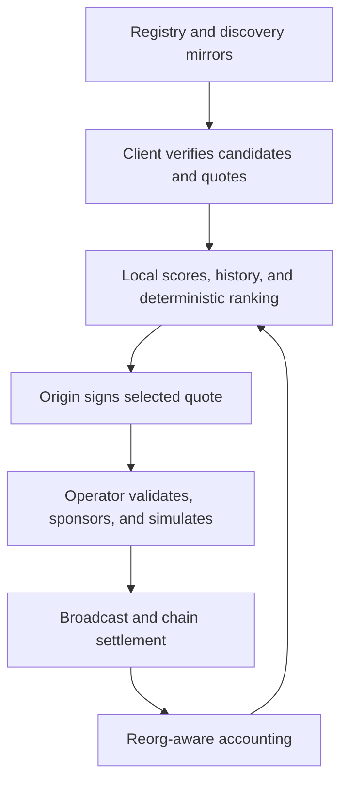

# OSSR Deterministic Weighted Fair Routing

**Specification ID:** OSSR-DWFR-001  
**Version:** 0.1.0-draft  
**Status:** Proposed OSSR v0.2 routing extension; not an implemented capability  
**Date:** 2026-10-07  
**Audience:** Wallet, SDK, relay, registry, and indexer implementers

## 1. Purpose

Deterministic Weighted Fair Routing (DWFR) lets a wallet or agent select an OSSR sponsor locally, using authenticated operator identities, signed quotes, bounded quality and seniority weights, and an auditable weighted lottery. It provides a deterministic fallback order and durable accounting of the economic opportunities offered to operators.

The objective is to balance user cost, operator sustainability, service reliability, and open participation. Registration order gives a limited advantage. Large balances do not directly buy a larger share of routing.

**The routing decision is advisory, not chain consensus.** Independent clients can choose different policies, discovery sources, and operators. Identical committed inputs produce an identical ranking; different candidate sets or histories do not. DWFR cannot enforce globally equal earnings, identify all common owners, guarantee profitability, or prevent a user from selecting an operator directly.

## 2. Normative language and baseline

MUST, MUST NOT, SHOULD, SHOULD NOT, and MAY describe requirements of this proposed specification. Numeric defaults are initial testnet policy choices, not measured optimums or existing OSSR settings.

The supplied *OSSR Technical Explanation*, prepared October 5, 2026 from repository snapshot `bcd186b` and inspected working-tree sources, is the implementation baseline [1]. It describes:

| Area | Baseline behavior | DWFR extension |
| --- | --- | --- |
| Operators | Single testnet relay | Independently registered operators |
| Supported action | Allowlisted `sbtc-sponsored-transfer-v1.sponsored-transfer` | Capability-specific routing; existing transfer remains first integration |
| Quotes | SIP-018 offer, operator and intent binding | Mandatory client verification; optional separately signed routing envelope |
| Settlement | Atomic recipient transfer and reimbursement to `tx-sponsor?` | Same settlement principle; routing creates no treasury cut |
| Fee policy | Logarithmic fee plus live cost floor | Preserve operator quote policy and user ceiling |
| Persistence | Local quote and sponsor nonce files | Durable router journal and transactional operator reservations |
| Client verification | Prototype helper verification gap | Production release blocker |
| Failover | Ambiguous broadcast reservations retained | Explicit cross-operator origin-nonce safety policy |

This document specifies routing, not arbitrary-call adapters, swap settlement, batching, x402 support, or mainnet readiness. Those integrations require separate specifications and contract reviews.

## 3. Security and economic invariants

1. A client MUST verify the operator identity, quote signature, network, intent, asset, adapter, fee, expiry, and key validity before user signing.
2. A routing service MUST NOT require custody of a user's keys or assets.
3. A client MUST NOT exceed the user's authorized token outflow or sponsor fee ceiling.
4. Invalid or incompatible operators MUST receive zero automatic routing weight.
5. Seniority MUST be a bounded multiplier of at most `1.10`, before fairness adjustment and normalization.
6. An eligible operator's balance or bond MUST NOT directly multiply its routing weight.
7. Estimated and realized profit MUST be distinct. Operator-reported profit MUST NOT drive fairness.
8. A successful HTTP submission MUST NOT be recorded as confirmed settlement.
9. An uncertain broadcast MUST NOT trigger automatic submission of another economic intent.
10. Discovery, scoring, and hosting MUST NOT depend on a mandatory OSSR-operated server.
11. Users MUST retain direct operator selection subject to the same quote and transaction safety checks.
12. No endpoint, ASN, bond, or public key is proof of a unique human or independent beneficial owner.

## 4. Architecture and trust boundaries



The registry authenticates registration records. Mirrors distribute records but cannot create registry authority. Operators authenticate their own quotes. The client authorizes selection, signing, and retries. Chain data establishes included transaction outcomes. Each operator owns its sponsor nonce and signing policy.

An optional indexer may publish metrics or reproducibility bundles. Its signature identifies the publisher; it does not make its claims true. Clients MUST identify the provenance of every non-chain measurement.

## 5. Routing profiles

### 5.1 `dwfr-local-v1` — required first implementation

The wallet maintains its own routing journal, probes, and outcomes. The registry is independently verifiable. Selection is immediate and reproducible from the client's saved snapshot.

Fairness applies only to traffic observed by that router instance. A user's wallets MAY synchronize encrypted journals, but such synchronization is not a protocol requirement. Wallet reinstalls and clients starting from empty history reset local fairness. This profile makes no global earnings guarantee.

### 5.2 `dwfr-audit-v1` — optional shared-history extension

An auditable signed snapshot may supply common observations. Clients MUST retain source receipts, transaction IDs, block anchors, snapshot policy, and membership rules; one publisher MUST NOT be mandatory.

On-chain success alone does not reveal requests never dispatched, missed opportunities, or total demand. Shared fairness therefore remains conditional on the completeness and integrity of the published observation set. Adoption of a snapshot is voluntary. A consensus protocol for globally authoritative history is outside this draft.

### 5.3 `dwfr-commit-v1` — experimental delayed-randomness extension

A request and candidate snapshot are committed before a specified future chain block. Its hash contributes to the seed only after the commitment is included and reaches the configured confirmation depth.

This increases request latency and may require renewing quotes. It MUST NOT be presented as unbiased randomness: block producers may have influence, and clients may create multiple commitments. Admission costs, one-shot commitments, and a randomness threat analysis are prerequisites. This profile MUST remain disabled in the first release.

## 6. Operator registry and identity

The proposed registry SHOULD be an on-chain contract readable through independent nodes. The first implementation MAY use an explicitly pinned signed manifest for testnet development, but MUST label its centralized registration authority.

| Field | Type | Requirement |
| --- | --- | --- |
| `operator_id` | 32-byte hash | Stable across endpoint and quote-key rotations |
| `network_chain_id` | uint | Mandatory network binding |
| `sponsor_principal` | Stacks principal | Registry identity authority and settlement sponsor |
| `registration_seq` | uint | Immutable monotonically assigned registration ordinal |
| `registration_height` | uint | Canonical registration inclusion height |
| `quote_keys` | Key records | Public key, key ID, valid-from height, valid-until height, revocation status |
| `endpoint_manifest_hash` | 32-byte hash | Commits to downloadable endpoint manifest |
| `capability_manifest_hash` | 32-byte hash | Commits to supported actions, tokens, and adapter versions |
| `status` | enum | `pending`, `active`, `exiting`, `inactive` |
| `bond_amount_microstx` | uint | Admission collateral, if enabled |
| `policy_hash` | 32-byte hash | Admission and registry rule version |

`operator_id = SHA256(JCS({domain:"ossr-operator-v1", chain_id, sponsor_principal}))`.

All integers inside hash inputs are canonical decimal strings. JCS is specified in Section 13.

Registry mutations MUST be authorized by the sponsor principal, or an explicitly configured registry authorization mechanism. Only one active registry entry per sponsor principal is permitted. Multiple principals can still belong to one owner.

Registration order MUST come from the canonical registry transaction order, not an endpoint's timestamp. If a registration is reorganized out, its ordinal is provisional until the entry exists in the confirmed registry snapshot. Clients MUST use a common block anchor when comparing records.

Endpoint changes and quote-key rotations retain registration order. Deregistration and re-entry MUST NOT reset local failure history or create repeated bootstrap bonuses. Key validity is evaluated at quote issue height, subject to revocation policy at execution; a client MUST reject a key revoked before signing.

### 6.1 Admission policy

Bond size, activation delay, and registration charges are policy parameters. This draft intentionally does not prescribe a production STX amount without traffic and attack-cost measurements.

A testnet admission policy MUST define its parameters explicitly. Mainnet activation is blocked until those choices have an economic threat model. Registration payments, if adopted, are separate from per-transaction reimbursement; DWFR introduces no per-transaction protocol cut.

Admission SHOULD combine a per-principal operational balance threshold, an activation delay, and durable identity history. A bond raises the cost of multiplying identities; it does not prove independence or prevent a wealthy adversary from registering many operators.

## 7. Discovery, privacy, and quote collection

Clients SHOULD support independent registry RPC providers, cached validated records, operator-hosted manifests, and optional community mirrors or Nostr discovery. Discovery advertisements MUST resolve back to authenticated registry records.

A client SHOULD build a bounded shortlist before requesting quotes. Requesting quotes from every operator leaks origin, recipient, amount, and activity timing to the entire network. The first integration SHOULD use at most five operators per quote round and disclose this privacy tradeoff.

Shortlists SHOULD rotate across local eligible identities using the same documented sampling method with a separate `ossr-discovery-v1` domain. The pre-quote shortlist MUST NOT use the fairness inverse-margin factor because no binding quote exists yet. Quotes MUST NOT be broadcast publicly by default.

The selection snapshot records all queried candidates, collection deadline, valid responses, rejected responses, and observed timeout results. A missing response has a reason code; it MUST NOT silently disappear from the local audit record.

Clients cannot prove that a mirror supplied every registered operator or that a remote request actually timed out. Candidate-set completeness is an explicit trust limitation. A hash of an incomplete set does not repair that limitation.

## 8. Eligibility and request constraints

An operator enters the final weighted ranking only when all checks pass:

| Check | Rule |
| --- | --- |
| Registry | Active in the anchored registry snapshot; activation delay satisfied |
| Identity | Sponsor and quote key match authenticated registry records |
| Capability | Exact network, token, adapter, action, and policy are supported |
| Quote | Valid signature, exact intent binding, fresh issue height, acceptable expiry |
| User price | Quote fee is at most `max_sponsor_fee_sats` |
| Competitive price | Quote fee is within the client's configured near-best envelope |
| Readiness | Recent local successful readiness observation and no local cooldown |
| STX liquidity | Observed balance less outstanding commitments covers configured runway |
| Capacity | Available sponsored-request slot; no known unresolved nonce conflict |
| Client safety | Known contract code/version and required post-conditions supported |

Initial price envelope:

```text
best_fee = minimum fee among valid quotes within the user's ceiling
price_limit = min(user_ceiling, best_fee + max(2, ceil(best_fee * 10 / 100)))
eligible_quote_fee <= price_limit
```

This limits the extra price a client accepts for fairness. Clients MAY choose a stricter envelope, including cheapest-only routing. Fairness MUST NOT silently override the user's cost preference.

Liquidity runway is a minimum capacity gate, not a ranking reward:

```text
free_microstx = observed_balance - known_reserved_network_fees
required_microstx = estimated_network_fee_microstx * runway_transactions
free_microstx >= required_microstx
```

An endpoint's capacity assertion is advisory. The operator MUST recheck readiness and acquire its own transactional reservation before signing. If no candidate passes, return `NO_ELIGIBLE_OPERATOR`; do not relax fee ceilings or security checks automatically.

## 9. Metrics and bounded quality score

Scores use fixed-point integers: `10_000 = 1.00`. Values are clamped to `[0, 10_000]`. Measurements are specific to a network/action/asset class and identified by provenance.

### 9.1 Reliability `R_i`

Count the router's attributable resolved attempts over its rolling window. A success requires confirmed adapter execution. An attributable failure includes invalid operator signatures, violating a signed offer, or an explicitly accepted attempt that objectively fails an operator obligation.

User-invalid requests, expired unsigned quotes, and unresolved broadcasts do not count as attributable operator failures. Timeouts are local service observations, not objective evidence of malice.

```text
R_i = floor(10_000 * (successes_i + 9) / (successes_i + failures_i + 10))
```

The prior gives a new operator `0.90` reliability and avoids division by zero. It is a startup assumption, not established reputation. Append-only evidence records and classifier versions MUST accompany counters.

### 9.2 Price efficiency `P_i`

```text
P_i = floor(10_000 * best_eligible_fee / quote_fee_i)
```

Every quote fee must be positive. This score rewards a competitive signed quote, not an operator's advertised minimum.

### 9.3 Availability `U_i`

Use independently scheduled local readiness probes, at most one scored observation per operator per five-minute bucket. Do not let operators manufacture repeated successful probes. Missing measurements are distinct from failed scheduled probes.

```text
U_i = floor(10_000 * (successful_probes_i + 9) / (scored_probes_i + 10))
Q_i = floor((50 * R_i + 30 * P_i + 20 * U_i) / 100)
```

An initial reliability cutoff is `R_i >= 9_000` only after 50 resolved attributable attempts. Before that, admission and hard safety gates apply. A failed gate or cooldown still excludes a new operator. Probe intervals and classifier defaults require calibration on testnet.

Latency is measured locally and recorded for analysis. It is not a global quality input in this initial profile, because geography and probing conditions make it difficult to compare fairly. Capital is a capacity gate; seniority is a separate bounded multiplier; infrastructure diversity is an advisory grouping policy.

## 10. Registration priority and onboarding

### 10.1 Bounded seniority

Let `seq_i >= 1` be the immutable registration ordinal. Let `active_seconds_i` be the duration of locally verified healthy readiness buckets since the current activation, capped at 90 days. Global operator-reported uptime does not count as verified active time.

```text
registration_i = floor(10_000 * 32 / (32 + seq_i - 1))
activity_i = min(10_000, floor(10_000 * active_seconds_i / (90 * 86_400)))
seniority_i = floor((registration_i + activity_i) / 2)
S_i = 10_000 + floor(1_000 * seniority_i / 10_000)
```

`S_i` lies in `[10_000, 11_000]`. An equally qualified earliest operator can therefore have at most a 10% larger base weight than an operator with no seniority contribution. This is not a guaranteed ten percentage-point market share advantage. Fairness may temporarily favor a later operator.

| Registration sequence | Verified active days | `S_i` approximately |
| ---: | ---: | ---: |
| 1 | 90 | 1.1000 |
| 5 | 90 | 1.0944 |
| 50 | 30 | 1.0364 |
| 100 | 0 | 1.0122 |

Inactive time provides no active-time credit. A registration ordinal cannot be purchased by taking over another endpoint; sponsor-identity transfer and registry migration require a separate reviewed policy.

### 10.2 Bootstrap

The production default is `B_i = 10_000`. Equal priors already allow new eligible operators to receive nonzero probability.

A testnet policy MAY use `B_i = 11_500` until the earlier of seven days after activation or 100 accepted assignments. The bonus MUST be tracked by stable identity and MUST NOT reset on key rotation or endpoint changes. Without credible admission costs, identity multiplication exploits this bonus; it MUST therefore remain off for permissionless production until reviewed.

### 10.3 Observable groups

Entries using the same sponsor principal are one identity. Clients MAY additionally group entries sharing cryptographically declared control. Endpoint, IP, ASN, hosting provider, and payout similarities are hints; none proves common ownership.

Grouping MUST be explicit in the snapshot and reversible as local policy. ASN sharing alone MUST NOT trigger exclusion or slashing. A group-aware client MAY run the lottery on groups, using `max(base_weight_member)` as the group base weight and aggregated fairness history, then choose a compatible member. This prevents confirmed aliases from multiplying base weight but does not stop undeclared aliases. The first reference profile uses identity-level routing; group routing requires a distinct policy version.

## 11. Economic model and fairness accounting

### 11.1 Preserve the quote's fee policy

For a valid positive sBTC transfer amount `A`, the baseline default policy is:

```text
U = ceil(A / 100)
L = 2 * ceil_log2(1 + U)
C = ceil(network_cost_in_sats) + infrastructure + risk_reserve + minimum_profit
F = max(1, L, C)
```

The default curve yields at least two sats. A generic override can differ, as described in [1]. DWFR verifies the signed exact fee; it does not turn the default minimum into a new on-chain invariant.

Cost floors protect estimates, not guaranteed realized profit. Included aborts can consume STX without reimbursement. Profitability also depends on actual execution cost, pricing moves, fixed expenses, failures, and traffic volume.

### 11.2 Expected contribution, not private reported profit

Fairness uses a reproducible model of contribution after standardized variable costs. It MUST NOT use an operator's declared server bill, claimed loss, or reported net profit.

For each request snapshot, the client records one shared reference network-cost estimate `G_r`, a reference infrastructure allowance `I_r`, and a reference abort-risk allowance `R_r`, all in sats. Their source, age, rounding, and policy are recorded. All candidates for that request use the same reference costs.

```text
M_i = quote_fee_i - G_r - I_r - R_r
eligible economic margin requires M_i >= minimum_model_margin_sats
```

The initial model minimum is one sat. A quote that does not meet the model may still be safe but is excluded from this automatic sustainability profile. Direct selection may accept it with the user ceiling intact. These allowances are router policy, not compulsory protocol-wide prices or reimbursements.

`G_r` is computed from a client-side transaction-size/fee model and an independently authenticated STX/BTC price source. It MUST NOT be copied from an operator's unverified claimed cost. Quote expiry, actual size, and sponsor network-fee cap are checked again before signing and broadcast.

Realized contribution MAY be displayed separately using confirmed token reimbursement and included STX fee converted under a named accounting price policy. Private fixed costs remain unknowable. Fairness promises concern modeled economic opportunity, not exact equal profit.

### 11.3 Local target and assigned opportunity

Maintain a 24-hour rolling journal per `(chain_id, action, asset)` class. For each operator:

| Symbol | Meaning |
| --- | --- |
| `V_i` | Base weight from quality, seniority, and optional bootstrap |
| `T_i` | Target modeled contribution accrued while eligible |
| `A_i` | Modeled contribution of assignments accepted by that operator |
| `epsilon` | Smoothing amount, initially 100 sats |

Targets and assignments are represented in micro-sats (`1 sat = 1_000_000 micro-sats`) to limit rounding bias. A new operator has `T_i = A_i = 0`; it inherits no target from time before admission or while offline.

Before selection:

```text
fairness_i = clamp(
    floor(10_000 * (T_i + epsilon) / (A_i + epsilon)),
    5_000,
    15_000
)
```

Here `epsilon` is converted to micro-sats. Its only purpose is smoothing and zero protection. `fairness_i` is bounded between `0.50` and `1.50`; it cannot restore an ineligible operator.

After the selected operator durably acknowledges acceptance, let `m` be its snapshotted `M_i` in micro-sats. Accrue `m * V_j / sum(V)` to every operator eligible for that attempt and add `m` to the selected operator's `A_i`. Distribute integer remainder by largest fractional remainder, ties by ascending operator ID, so total target increments equal the assignment increment exactly.

The journal records targets and the selected debit atomically. Pending accepted assignments already count in `A_i`, preventing bursts from repeatedly selecting an operator whose success is not yet confirmed. A declined quote before acceptance does not accrue economic targets; its service failure may still affect local health metrics. Reserve a provisional local debit while acceptance is outstanding, and release it only when the acceptance state is resolved.

Accepted operator failures retain the assignment debit: deliberately failing MUST NOT buy a fairness boost. A definitively unexecuted user cancellation or external-network failure MAY reverse the entire attempt's target and assignment changes under a versioned evidence-based classifier. An ambiguous result retains the debit. TTL expiry alone does not establish a safe cancellation.

All reversals MUST update the exact original increments, once, and be journaled. Targets and assignments age out together by attempt acceptance time. Reorgs update chain-outcome metrics; they do not erase the fact an opportunity was accepted unless the classified attempt is explicitly reversed.

### 11.4 Margin-normalized final weights

```text
V_i = max(1, floor(Q_i * S_i * B_i / 10_000^2))
W_i = max(1, floor(V_i * fairness_i * 1_000_000 / (10_000 * M_i)))
probability_i = W_i / sum(W)
```

`M_i` is a positive integer sat amount. Dividing by modeled margin reduces the number of high-margin assignments needed to reach an operator's contribution target. Without this normalization, equal transaction counts can produce unequal economic opportunity.

The approach is a bounded adaptive lottery, not a strict fair-queuing guarantee. At low volume or with unequal request eligibility, realized shares can differ substantially from targets. Rolling-window smoothing, inverse-margin weighting, fee gates, and randomness must be evaluated together in simulation.

Clients MUST apply a reasonable quote and candidate count bound to avoid pathological weight magnitudes. The initial profile caps a snapshot at 64 candidates and uses arbitrary-precision arithmetic throughout. More candidates require an explicit policy change.

## 12. Deterministic selection and randomness limits

### 12.1 Committed input snapshot

A reproducibility bundle contains:

- Versioned routing policy and its hash.
- Chain ID, anchored registry block hash/height, and registry records or verifiable references.
- Request intent hash and client-generated request ID.
- Candidate and rejected-response list with signed quote payloads and exclusion reasons.
- Metric provenance, local history digest, target/assignment counters, cost model, and final integer weights.
- Seed fields, resulting ranking, and attempt/failover decisions.

Candidates MUST be sorted by raw operator ID bytes before hashing and sampling. All policy and score inputs MUST be fixed before producing the ranking. A client MUST NOT retry request IDs, quote subsets, deadlines, or weights to improve a preferred operator's result while claiming adherence to the saved decision.

The audit bundle proves the calculation over the recorded inputs. It does not prove those inputs were complete, honestly measured, or the only inputs the client tried.

### 12.2 Immediate seed

```text
request_id = 32 bytes from the client's operating-system CSPRNG
seed = SHA256(JCS({
  domain: "ossr-dwfr-seed-v1",
  chain_id,
  profile,
  policy_hash,
  anchor_block_hash,
  registry_snapshot_hash,
  candidate_snapshot_hash,
  history_snapshot_hash,
  intent_hash,
  request_id
}))
```

`anchor_block_hash` is a specified sufficiently confirmed chain block. A recent block hash is public context, not secret or unpredictable randomness. The local random request ID reduces predictable routing for honest clients, but a malicious client can grind IDs or choose a direct operator anyway.

Immediate DWFR therefore provides reproducibility, not publicly enforced unbiasability. The optional delayed-commit profile in Section 5.3 changes this threat model and latency; it is not required for ordinary wallet routing.

### 12.3 Weighted ranking without replacement

Generate a full ranking by repeatedly drawing a weighted winner and removing it. Do not sort hash values and call that a weighted lottery.

For remaining total weight `T`, interpret a domain-separated SHA-256 output as an unsigned 256-bit big-endian integer `x`. Use rejection sampling:

```text
limit = 2^256 - (2^256 mod T)
reject x if x >= limit
draw = x mod T
```

Choose the first ascending-ID candidate whose cumulative weight is strictly greater than `draw`. Remove it, then repeat with the next ranking position. A single candidate wins without a draw. Every eligible positive-weight candidate appears exactly once.

Each draw input is `JCS({domain:"ossr-dwfr-draw-v1", seed, position, retry})`, with counters as decimal strings. Increment `retry` only after rejection; reset it for each position. Implementations MUST NOT use floating-point logarithms, percentages, or modulo without rejection for this lottery.

## 13. Encoding, signatures, and protocol objects

Hash-input objects MUST use RFC 8785 JSON Canonicalization Scheme [4], UTF-8, no duplicate keys, and valid Unicode. Hashes and IDs are lowercase fixed-width hex without `0x`; binary data uses lowercase hex. All hash-input integers are decimal strings without leading zeros; negative integers are disallowed unless a field explicitly permits them. Array order is semantic and specified by the containing object.

Quote signatures retain the existing SIP-018 Clarity structured-data schema [1, 2]. JSON hashing does not replace SIP-018 serialization. New routing objects use separate domain/version identifiers; quote fields MUST NOT be silently added to an existing signed schema.

An operator MAY provide a separately SIP-018-signed routing envelope containing `routing_request_id`, `operator_id`, `quote_payload_hash`, `registry_anchor_hash`, `issue_height`, and `expiry_height`. Hash `quote_payload_hash` over the exact canonical signed quote message bytes, excluding signature encoding. Publish the routing-envelope Clarity schema and cross-language vectors before using it for security decisions.

Illustrative wire object; placeholder IDs are not executable test vectors:

```json
{
  "spec": "ossr-dwfr-1",
  "profile": "dwfr-local-v1",
  "chain_id": "2147483648",
  "routing_request_id": "<32-byte-lowercase-hex>",
  "policy_hash": "<32-byte-lowercase-hex>",
  "anchor": {
    "height": "<decimal-height>",
    "block_hash": "<32-byte-lowercase-hex>"
  },
  "intent_hash": "<32-byte-lowercase-hex>",
  "max_sponsor_fee_sats": "20",
  "candidates": [
    {
      "operator_id": "<32-byte-lowercase-hex>",
      "quote_payload_hash": "<32-byte-lowercase-hex>",
      "quality_bps": "9500",
      "seniority_bps": "10500",
      "bootstrap_bps": "10000",
      "fairness_bps": "12000",
      "modeled_margin_sats": "3",
      "weight": "3990000000"
    }
  ]
}
```

The example weight follows Sections 11.4: `V = 9975`, then `W = 3,990,000,000`. A real snapshot MUST include or authenticate every omitted scoring input.

## 14. Sponsorship lifecycle and safe failover

### 14.1 State model

| State | Meaning | Automatic next-operator attempt? |
| --- | --- | --- |
| `QUOTED` | Offers collected; no signed origin bytes submitted | Yes, after quote verification |
| `ORIGIN_SIGNED` | User authorized selected quote | Only before any submission; changed quote fields require re-signing |
| `SUBMITTING` | Bytes sent; acceptance not yet resolved | No, reconcile first |
| `ACCEPTED` | Operator durably reserved attempt and sponsor nonce | No, until definitive release or terminal chain resolution |
| `SIGNED` | Fully sponsored bytes may exist | No, signed bytes may be broadcast later |
| `BROADCAST_UNKNOWN` | A broadcast could have succeeded | No |
| `PENDING` | Transaction observed but unconfirmed | No |
| `CONFIRMED_SUCCESS` | Required depth and successful adapter execution | No retry; settle accounting |
| `CONFIRMED_ABORT` | Included abort consumed origin nonce and possibly STX fee | A new transaction requires refreshed intent, nonce, quote, and user authorization |
| `REJECTED_NOT_SIGNED` | Authenticated definitive pre-sign rejection | Yes; move to next ranked operator |
| `EXPIRED_UNEXECUTED` | Quote expired and attempt classified unexecuted under chain policy | Only after nonce and broadcast reconciliation |
| `REORGED` | Previously observed inclusion no longer canonical | No, reconcile from canonical chain |

### 14.2 Quote-specific origin authorization

The current transfer transaction includes amount, recipient, sponsor fee, quote ID, expiry height, and memo. Switching operators commonly changes these fields. A fallback MUST obtain or reuse a still-valid signed quote for that operator, rebuild the transaction, and obtain a fresh origin signature when any origin-authorized field changes.

This draft does not assume a single wallet signature authorizes an arbitrary operator, a different fee, or a replacement quote. Automatic user signing is possible only through a separately authorized wallet/session policy.

The adapter's use of `tx-sponsor?` for reimbursement does not on its own enforce an exclusive off-chain assignment. Binding and reservations protect the participating operator workflow; a client MUST also verify the final sponsor and network fee on fully signed transaction bytes before treating them as the selected offer.

### 14.3 Duplicate and ambiguous submissions

The router MUST lock an unresolved `(chain_id, origin_principal, origin_nonce)` intent in a durable transactional journal. Locks MUST persist across restarts. An idempotency key identifies one operator attempt, and changed bytes under the same key are rejected.

Each operator MUST serialize its sponsor nonce reservations independently; a shared signer across hosts requires a common transactional reservation system. A router lock cannot replace the operator's signer lock.

After uncertainty, query the operator by attempt ID, derive or retrieve the signed transaction ID, inspect canonical chain state and mempool through independent sources, and retry identical bytes only through an idempotent path. Absence from one RPC or mempool is not proof that signed bytes can never be broadcast.

A signed `REJECTED_NOT_SIGNED` response should explicitly state that the operator generated no sponsor signature. This is an authenticated commitment, not mathematical proof of absence. A malicious operator may lie. Conservative clients must retain this limitation in their threat model.

For stronger failover, wait for the adapter's quote expiry to pass and the configured reconciliation depth, then refresh the origin nonce and confirm canonical nonexecution. A late old transaction may still enter the chain and abort, consuming the origin nonce; expiry prevents successful old adapter settlement, not all inclusion or gas cost. Same-origin-nonce alternatives prevent both intents from succeeding on one canonical chain, but one may block or abort the other. Never automatically advance the origin nonce while the original attempt is unresolved.

### 14.4 Ranked fallback policy

Walk the saved ranking; skip candidates now invalid, expired, unavailable, or above the user ceiling. Refresh changed quotes and authorization. The ranking MUST NOT be regenerated solely to favor another operator; an expired snapshot starts a new logged quote round.

Initial limits are two fallbacks after the primary and three total submission attempts per routing request. Health and quote collection timeouts do not imply safe abandonment of an accepted transaction.

## 15. API extensions and receipts

Keep the baseline `/v1/info`, `/v1/quotes`, `/v1/sponsorships`, and transaction-status endpoints [1]. The following are proposed additions, not existing endpoints:

| Endpoint/object | Purpose |
| --- | --- |
| `GET /v2/operator-manifest` | Registry-bound endpoint, key, and capability metadata |
| `POST /v2/quotes` | Versioned request ID and explicit action class; returns existing-schema quote plus optional routing envelope |
| `POST /v2/sponsorships` | Origin bytes, quote, request ID, and idempotency key |
| `GET /v2/attempts/{attempt_id}` | Durable attempt state, signed transaction ID if generated, and reconciliation evidence |
| `AcceptanceReceipt` | Signed durable acceptance with quote/intent/bytes hashes, attempt ID, and sponsor identity |
| `RejectionReceipt` | Signed failure code and explicit pre-sign or post-sign stage |
| `OutcomeReceipt` | Signed observation referencing txid, block hash/height, status, and network fee |

A receipt signature does not prove chain finality or the truth of an unavailable service claim. Clients verify chain outcomes independently. Receipt signature domains and full Clarity tuple schemas MUST be pinned before interoperable deployment.

| Error | Required handling |
| --- | --- |
| `NO_ELIGIBLE_OPERATOR` | Stop automatic routing; explain constraints |
| `QUOTE_SIGNATURE_INVALID` | Exclude; record cryptographic evidence |
| `REGISTRY_KEY_REVOKED` | Reject quote before signing |
| `SPONSOR_FEE_TOO_HIGH` | Ask for a different quote within ceiling; never increase ceiling silently |
| `PRICING_UNAVAILABLE` | No sustainability-model quote/selection; report dependency issue |
| `INSUFFICIENT_SPONSOR_LIQUIDITY` | Skip before signing or accept definitive pre-sign rejection |
| `ATTEMPT_IN_PROGRESS` | Poll existing attempt |
| `BROADCAST_AMBIGUOUS` | Retain locks; reconcile |
| `SNAPSHOT_STALE` | Recollect and record a new snapshot |
| `POLICY_UNSUPPORTED` | Reject automatic routing under that policy |

## 16. Threat model and mitigations

| Threat | Mitigation | Remaining limitation |
| --- | --- | --- |
| Router favoritism | Local selection; saved input hashes and ranking | A client can use another policy or hide omitted candidates |
| Mirror censorship | Independent providers; cached registry verification | A client may never discover some operators |
| Client or quote-ID grinding | Honest-client one-shot request IDs; saved snapshots | Immediate mode does not enforce unbiased choice |
| Chain randomness manipulation | No unbiased-randomness claim; experimental commit profile | Producers and repeated commitments can influence delayed mode |
| Sybil identities | Admission cost/delay, stable history, known-owner groups, bootstrap off | Permissionless independent ownership cannot be proven |
| Wealth concentration | Capacity gate and no bond multiplier | Capital still supports more identities and service capacity |
| Fee gouging | User ceiling, near-best envelope, signed exact fee | Users may choose higher service margins voluntarily |
| Cost or loss fabrication | Shared client cost model; assignment fairness | Model may differ from actual operator economics |
| Failure farming | Retain accepted-opportunity debit; cooldown | Failure classification is partly local and imperfect |
| Self-traffic reputation farming | Local observations; sample/provenance policy | Shared on-chain volume alone does not prove organic demand |
| Receipt fabrication | Operator signatures plus independent chain checks | Non-chain failures and availability remain difficult to prove |
| Nonce race/double sponsorship | Durable origin lock and serialized sponsor signer | Separate wallets require coordinated origin-nonce management |
| Key compromise | Registry revocation, isolated signer, bounded fees, rotation | Previously signed bytes and delayed revocation can remain dangerous |
| Reorg/RPC equivocation | Anchored snapshots, confirmation policy, independent observations | Confirmation depth reduces risk; it is not absolute finality |
| Privacy leakage | Bounded private quote shortlist; minimize audit disclosure | Queried operators learn request details |
| Denial of service | Rate limits, bounded candidate sets, request-size caps | Limits can affect availability; do not become an exclusive gatekeeper |

No automatic financial slashing is specified. Timeouts, failed RPC calls, reorgs, or an allegedly invalid quote MUST NOT cause bond confiscation under this draft. Slashing requires a separate contract with objective evidence rules, cryptographic verification, narrowly defined violations, and dispute behavior. Two different quotes or sponsor signatures are not inherently a slashable conflict.

## 17. Initial configurable policy

| Parameter | Initial value | Interpretation |
| --- | --- | --- |
| Routing profile | `dwfr-local-v1` | Immediate, local-history routing |
| Quote shortlist | 5 | Privacy/coverage tradeoff |
| Maximum snapshot candidates | 64 | Resource bound |
| Fairness window | 86,400 seconds | Local rolling opportunity accounting |
| Fairness smoothing | 100 sats | Prevent extreme cold-start ratios |
| Fairness range | 0.50–1.50 | Bounded correction |
| Seniority maximum | 1.10 | Base-weight multiplier cap |
| Bootstrap multiplier | 1.00 | Production disabled |
| Optional testnet bootstrap | 1.15; 7 days or 100 assignments | Earlier boundary ends bonus |
| Quality weights | R 50%, P 30%, U 20% | Reliability, price, availability |
| Attribution sample cutoff | 50 attempts | Minimum sample for reliability cutoff |
| Reliability eligibility cutoff | 0.90 | Applied after sample cutoff |
| Readiness probe bucket | 300 seconds | At most one scored probe per bucket |
| Local readiness freshness | 60 seconds | Fresh request-time observation required |
| STX runway | 10 estimated transactions | Eligibility only |
| Price tolerance | best + max(2 sats, ceil(10% of best)) | User ceiling still dominates |
| Minimum modeled contribution | 1 sat | Sustainability-profile gate |
| Quote collection deadline | 2,000 ms | Local measurement, not global evidence |
| Pre-acceptance response timeout | 5,000 ms | Timeout triggers reconciliation if bytes were submitted |
| Maximum submission attempts | 3 | Primary plus two safe fallbacks |
| Registry/outcome confirmations | Explicit network policy; 6 for initial testnet experiments | Must be calibrated; not a universal finality guarantee |
| Quote expiry safety margin | 2 blocks | Candidate expiry must exceed current tip by this margin |
| Accepted-opportunity accounting | Immediate | Pending work already consumes allocation |
| Bond / activation delay | Required explicit admission policy | No inferred production default |

UTC times come from the router's monotonic/persisted clock model. Clock rollback MUST NOT create negative ages or erase journals. Block expiry is enforced in chain height, not wall time. Quote lifetime remains the operator's signed offer; the PDF reports ten blocks by default for the baseline [1].

Every policy object MUST be versioned and hashed. A client MUST show material pricing/routing preference changes and MUST NOT adopt unsigned remote policy updates silently. A policy transition retains original per-attempt accounting and starts a new scoring snapshot.

## 18. Reference pseudocode

```python
def select(request, registry, local_journal, policy):
    anchor = choose_confirmed_anchor(policy.confirmations)
    records = verify_registry(registry, anchor, request.chain_id)
    shortlist = discover_and_sample(records, request, local_journal, policy)
    responses = collect_signed_quotes(shortlist, request, policy.quote_deadline_ms)
    quotes = verify_quotes_and_intents(responses, records, request, anchor)
    quotes = apply_user_ceiling_and_price_envelope(quotes, request, policy)
    costs = independent_reference_cost_model(request, quotes, policy)
    eligible = []

    for quote in quotes:
        if not readiness_capacity_and_safety_pass(quote, policy):
            continue
        margin = quote.fee_sats - costs.gas - costs.infra - costs.risk
        if margin < policy.minimum_model_margin_sats:
            continue
        eligible.append((quote, margin))

    if not eligible:
        raise NoEligibleOperator()
    best_eligible_fee = min(quote.fee_sats for quote, margin in eligible)
    candidates = []
    for quote, margin in eligible:
        metrics = local_journal.metrics(quote.operator_id, request.class_id)
        quality = quality_score_integer(metrics, quote, best_eligible_fee)
        seniority = bounded_seniority(records[quote.operator_id], metrics)
        bootstrap = policy.bootstrap_for_stable_identity(quote.operator_id)
        base = max(1, quality * seniority * bootstrap // 10000**2)
        target, assigned = local_journal.rolling_opportunities(quote.operator_id)
        eps = policy.epsilon_sats * 1000000
        fairness = clamp(10000 * (target + eps) // (assigned + eps), 5000, 15000)
        weight = max(1, base * fairness * 1000000 // (10000 * margin))
        candidates.append(candidate(quote, margin, base, weight))

    if not candidates:
        raise NoEligibleOperator()
    candidates.sort(key=lambda item: item.operator_id_bytes)
    snapshot = freeze_all_inputs(request, anchor, candidates, local_journal, policy)
    seed = hash_seed(snapshot)
    ranking = weighted_permutation(seed, candidates)
    local_journal.persist_decision(snapshot, ranking)
    return ranking


def weighted_permutation(seed, candidates):
    remaining = list(candidates)
    ranking = []
    for position in range(len(candidates)):
        total = sum(item.weight for item in remaining)
        if len(remaining) == 1:
            chosen = remaining[0]
        else:
            retry = 0
            limit = 2**256 - (2**256 % total)
            while True:
                x = hash_draw_as_uint256(seed, position, retry)
                if x < limit:
                    break
                retry += 1
            draw = x % total
            cumulative = 0
            for item in remaining:
                cumulative += item.weight
                if draw < cumulative:
                    chosen = item
                    break
        ranking.append(chosen)
        remaining.remove(chosen)
    return ranking


def execute_ranked_attempt(request, candidate, journal):
    # Lock and persist before sending signed user bytes to any operator.
    with journal.origin_nonce_transaction(request.origin, request.origin_nonce):
        verify_current_quote_registry_and_constraints(candidate, request)
        origin_bytes = obtain_origin_authorization(candidate.quote, request)
        attempt = journal.prepare_attempt(candidate, origin_bytes)
    reply = submit_idempotently(candidate, attempt, origin_bytes)
    # A timeout after submission is unresolved, not a safe next-operator signal.
    journal.resolve_or_mark_unknown(attempt, reply)
    if reply.is_authenticated_acceptance:
        journal.atomic_target_and_assignment_update(attempt)
    return reply
```

Concurrent calls MUST reserve provisional assignment debit before submission so all pending local decisions influence fairness. Journal recovery MUST resolve provisional entries against operator attempt state before permitting conflicting retries. Reference code must make these operations transactional; the pseudocode omits storage-specific mechanics.

## 19. Worked economic selection example

Assume all four quotes satisfy user price, capability, and readiness gates. Seniority is already included in `V`. This is an illustrative snapshot, not a measured traffic forecast.

| Operator | Base `V` | Target `T`, sats | Assigned `A`, sats | Fairness, with epsilon 100 | Modeled margin `M`, sats | Final `W` | First-choice probability |
| --- | ---: | ---: | ---: | ---: | ---: | ---: | ---: |
| A, earliest | 10,000 | 1,000 | 1,350 | 0.7586 | 4 | 1,896,500,000 | 19.6% |
| B | 9,500 | 950 | 900 | 1.0500 | 3 | 3,325,000,000 | 34.4% |
| C, later | 9,000 | 900 | 600 | 1.4285 | 3 | 4,285,500,000 | 44.3% |
| D, new | 1,000 | 0 | 0 | 1.0000 | 6 | 166,666,666 | 1.7% |

The four rows are the complete candidate set for this example. A's early-registration base advantage does not override its existing surplus. C receives more opportunities while below target. D has nonzero participation without a production bootstrap reward. In practice a new operator's quality prior determines its base; D's low base is a synthetic arithmetic example, not a default new-operator score.

If B accepts, its modeled debit is three sats. Targets accrue three sats across the four candidates in proportion to their base weights. The next decision uses updated targets and assignments, even while B's transaction is pending. Actual realized reimbursement and gas costs are recorded separately after chain reconciliation.

## 20. Verification and acceptance criteria

These are tests required for an eventual implementation, not claims that OSSR already passes them.

### 20.1 Cross-language determinism

- TypeScript and Rust produce byte-identical canonical snapshots, seeds, integer scores, and rankings from frozen fixtures.
- Fixtures cover reordered JSON properties, canonical candidate ordering, monetary values above `2^53`, invalid Unicode, duplicate JSON keys, and network/domain separation.
- Include full hexadecimal vectors for hash input, hash output, draw rejection, cumulative boundaries, and without-replacement ranking.
- Publish exact SIP-018 quote and routing-envelope schemas and signature vectors.

### 20.2 Economic and distribution properties

- Defaults satisfy seniority `<= 1.10`, bootstrap off, and fairness `[0.50, 1.50]`.
- One eligible candidate is selected every time; zero candidates yields a typed error.
- Every eligible positive-weight candidate appears once in the ranking.
- Fixed-seed simulations with at least 100,000 independent request IDs match expected first-choice weights within a declared statistical tolerance.
- Target increments sum exactly to assignment increments after rounding and reversals.
- Pending assignments affect later choices immediately and survive restart.
- Test low-volume variance, uneven eligibility, large-margin requests, join/leave churn, concentration, and increased quote costs. Report allocation and modeled contribution separately.
- Sybil simulations include 1, 10, and 100 controlled identities, both with and without bootstrap and admission costs. Report residual capture rather than claiming Sybil resistance from a bond alone.

### 20.3 Transaction safety and failures

- Quote tampering, wrong registry key, revoked key, wrong chain, changed recipient/amount/fee, wrong adapter, and expiry violations stop before signing or broadcast.
- Changing a fallback quote's bound fields requires origin reauthorization.
- Inject timeout after sponsor signing and after network acceptance; verify no blind cross-operator retry or nonce advancement.
- Restart the router and relay during each lifecycle stage; locks, reservations, and idempotent results remain recoverable.
- Included aborts consume no atomic sBTC reimbursement; accounting records STX loss separately.
- Simulate reorgs of registration, pending inclusion, confirmed outcome, and expiry reconciliation; preserve canonical anchors and invalidate stale decisions.
- Independent discovery sources can disappear without making the remaining registry-authorized operators unusable.

### 20.4 User and operator outcomes

Measure fee overhead relative to the cheapest safe quote, accepted-to-confirmed latency, attributable failures, unknown attempts, per-operator modeled contribution, realized contribution under a named price policy, and top-1/top-3 traffic concentration. Publish results by action and asset class.

No mainnet rollout is justified solely by a fair-looking simulation. Client verification, signer isolation, contracts, storage, registry authority, and recovery require independent review.

## 21. Implementation sequence and release gates

| Phase | Deliverable | Exit condition |
| --- | --- | --- |
| 1 | Local routing library and frozen policy | Scoring and weighted-permutation vectors agree across languages |
| 2 | Signed identity/registry prototype and quote verification | Keys, manifests, capabilities, and current transfer quotes independently verified |
| 3 | Durable journal, receipts, and safe fallback | Crash, nonce, timeout, and ambiguous-broadcast scenarios pass |
| 4 | Multi-operator testnet transfer experiment | Economic variance, cost overhead, and concentration published |
| 5 | Registry and admission hardening | Authority, key revocation, bond/delay economics, and recovery reviewed |
| 6 | Additional adapters or shared-history profiles | Separate security models, schemas, and test suites completed |

Production blockers: complete wire schemas and test vectors; verified client signatures; reviewed registry and admission rules; confirmed supported contract behavior; isolated operator signer; transactional durable storage; reorg-aware reconciliation; measured fee/profit risk; independently reviewed end-to-end deployment.

## 22. Decisions still requiring empirical validation

- Admission cost and activation delay sufficient to discourage cheap identity multiplication without excluding small operators.
- Near-best price envelope and modeled infrastructure/risk allowances appropriate to real transaction costs.
- Whether inverse-margin routing produces acceptable latency and user cost under mixed request sizes.
- Smoothing, fairness window, and quality cutoffs that work at modest traffic volumes.
- Meaningful and privacy-preserving shared-history evidence without a mandatory publisher.
- Practical confirmation depth and conservative failover policy for the chosen Stacks network.
- Whether delayed committed randomness adds enough value to justify blocks of additional latency.

Until validated, these parameters remain versioned testnet defaults. The fundamental tradeoff remains explicit: local permissionless routing offers verifiable decisions and user choice, while strong global fairness and owner-level Sybil resistance require additional coordination or trust assumptions.

## 23. References

[1] **OSSR Technical Explanation**, supplied PDF, prepared October 5, 2026, repository snapshot `bcd186b` and inspected working-tree sources. Pages 1–3: scope, sponsorship, quote security, atomic settlement, and abort risk. Pages 4–5: fee policy, overrides, limits, persistence, and endpoints. Page 6: evidence and production gaps. This draft uses that attachment as its implementation baseline; it does not claim to inspect a newer repository revision.

[2] [SIP-018: Signed Structured Data](https://github.com/stacksgov/sips/blob/main/sips/sip-018/sip-018-signed-structured-data.md). Primary source for the signed structured-data standard; retrieved October 7, 2026. Existing quote signatures retain this standard rather than adopting the routing JSON hash format.

[3] [Stacks transactions reference](https://docs.stacks.co/reference/stacks.js/stacks-transactions). Primary implementation documentation for transaction construction, sponsor signing, serialization, and signature verification; retrieved October 7, 2026. Implementations must pin their actual package version and test behavior.

[4] [RFC 8785: JSON Canonicalization Scheme](https://www.rfc-editor.org/rfc/rfc8785.html). Primary reference for canonical JSON encoding used in routing hash inputs; retrieved October 7, 2026.

All routing formulas, profiles, defaults, fairness accounting, admission recommendations, and lifecycle extensions in this document are proposed design decisions, not features established by these references.
